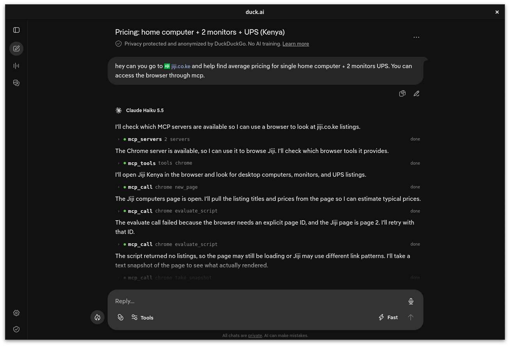
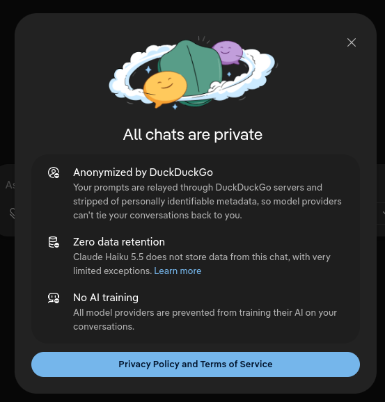
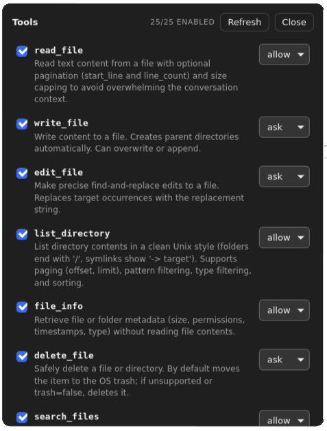
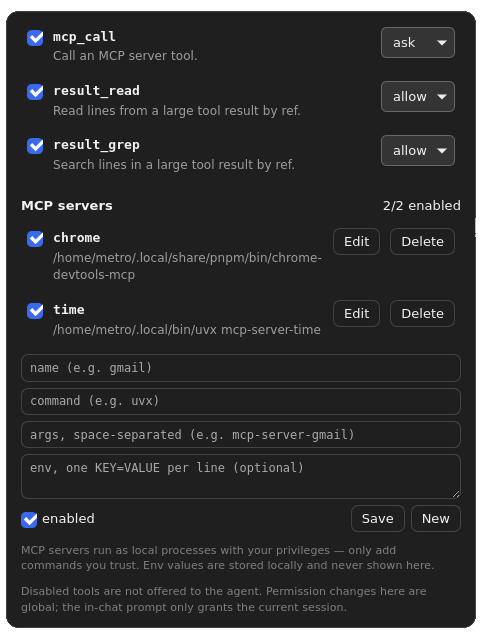
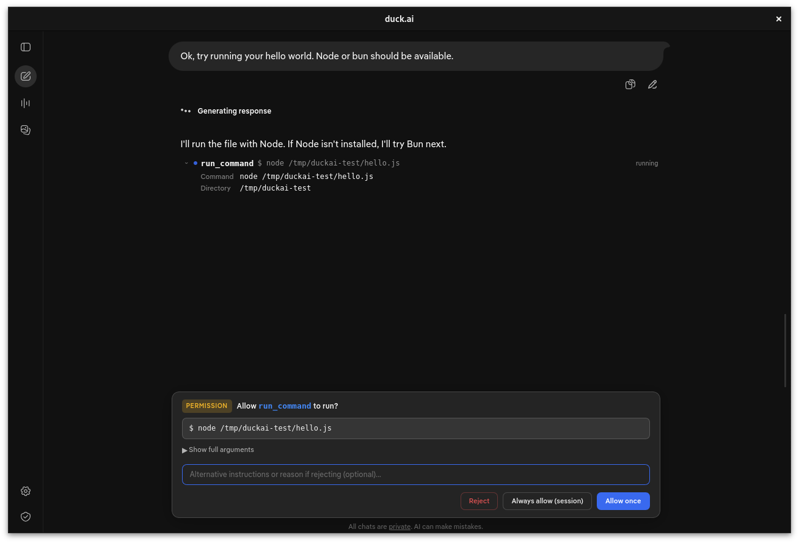
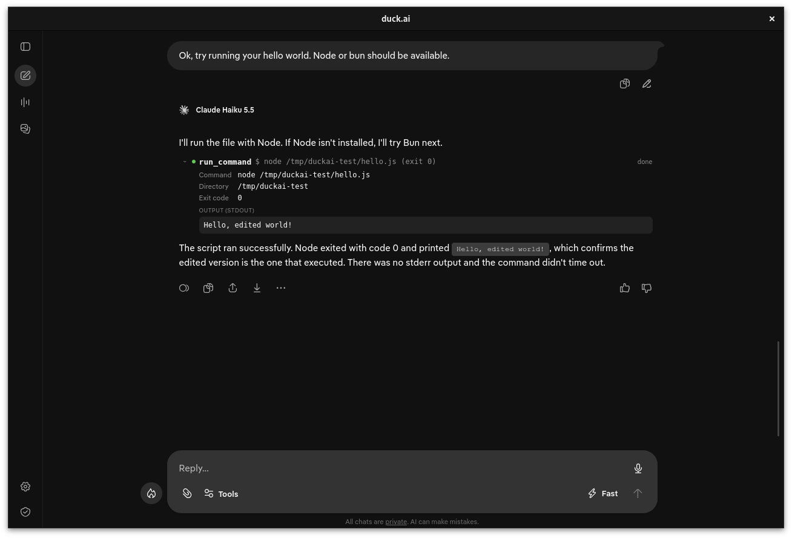
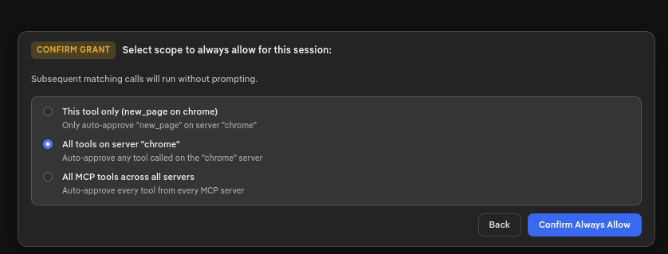
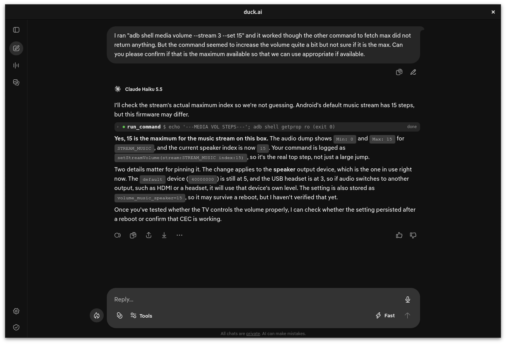
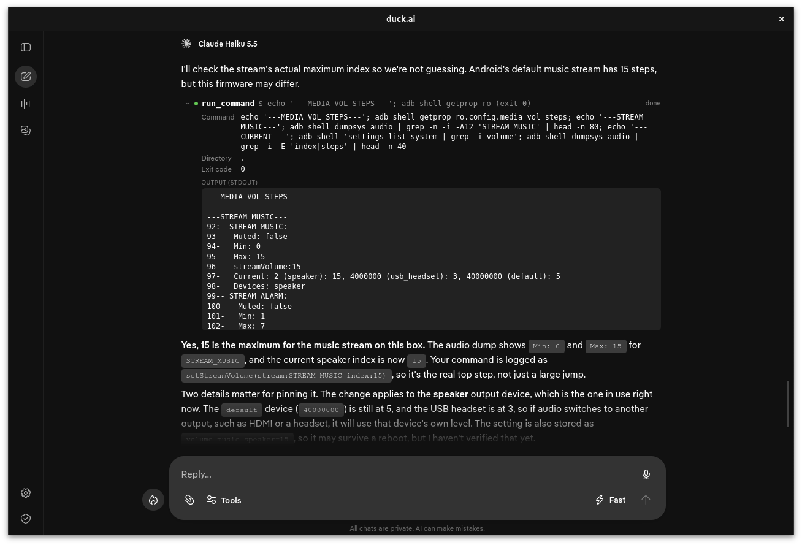
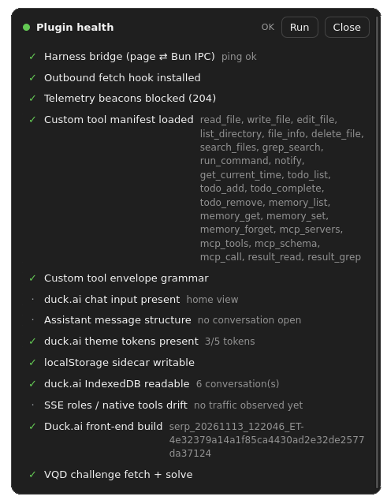

# duck.ai harness

An experimental, personal-use harness that wraps [duck.ai](https://duck.ai) in a native window and gives its models a way to use your computer. Files, shell commands, search, todos, memory, desktop notifications and MCP servers are exposed as tools and executed locally, with your approval.

<p align="center">
  
  <br>
  <sub>A Chrome MCP session: the agent browses Jiji Kenya, evaluates listings and reports back without leaving the chat.</sub>
</p>

## Install

### Debian / Ubuntu

Download the latest `.deb` from [Releases](https://github.com/OmentaElvis/duckai/releases/latest) and install it with `apt` so dependencies are resolved:

```bash
sudo apt install ./duckai_*_amd64.deb
```

Then launch **Duck.ai** from your application menu, or run `duckai` in a terminal.

Supported on **Debian 13+** and **Ubuntu 24.04+** (GTK 4 / WebKitGTK 6.0). Each release also includes a standalone `duckai-linux-x64` binary if you prefer not to use a package manager.

### From source

```bash
bun install
bun run dev        # build the injected script and launch the app
bun run build      # compile the linux-x64 binary to dist/duckai
bun run build:deb  # package dist/duckai_<version>_amd64.deb
```

## Why

DuckDuckGo's privacy model is the main draw for me: prompts are anonymized, chats are not retained (with limited exceptions), and conversations are not used for training. That is a big improvement over most providers, but you are still stuck being the tedious interface between the model and your machine, copying shell commands back and forth.

This harness removes that step. I can ask "help me figure out why my USB Bluetooth dongle isn't mounting", and the model runs the diagnostics itself, reads the output and continues. I also use it for everyday assistant work such as email triage.

<p align="center">
  
  <br>
  <sub>The privacy properties this harness is built around.</sub>
</p>

## How it works

The injected script hooks `fetch()` for duck.ai's completion endpoint. It appends a short user-side prompt describing the expected tool-call format (see `src/protocol.ts`) and watches the response stream for those markers. When the model emits a valid call, the host executes the tool, returns the result to the conversation, and the model keeps going.

Everything is client-side: it is a textual contract between the model and a local runner. Most of the code exists to make that contract reliable and the experience usable: permission prompts, rich tool rendering, history restoration, health checks and so on.

## Features

- **MCP servers**: the biggest extension point. Connect Chrome, Gmail, calendars or any other MCP service and expose its tools to the agent.
- **Filesystem**: read, write, edit, list, inspect and delete files and folders.
- **Shell**: run commands with timeouts and captured stdout/stderr.
- **Search**: glob-based file discovery and ripgrep-powered content search.
- **Todos**: a small todo list shared between you and the agent.
- **Memory**: long-term notes that survive across sessions.
- **Notifications**: desktop notifications and ntfy.sh push.
- **Permissions**: per-tool `allow` / `ask` / `deny` policies, an in-chat approval prompt with a session-scoped "always allow", and the ability to enable or disable any tool.

<table>
  <tr>
    <td align="center" width="50%">
      
      <br>
      <sub>Enable, disable and set a permission level for every tool.</sub>
    </td>
    <td align="center" width="50%">
      
      <br>
      <sub>MCP servers are added and toggled in the same panel.</sub>
    </td>
  </tr>
</table>

## Permissions

Tools default to `ask`, so a new or sensitive tool never runs silently. Requests appear inline above the prompt bar: allow once, reject (optionally with instructions the model can act on), or grant a scoped "always allow" for the session.

<p align="center">
  
  <br>
  <sub><b>1.</b> The agent asks before running <code>node hello.js</code>.</sub>
</p>

<p align="center">
  
  <br>
  <sub><b>2.</b> After approval, the output is rendered inline and sent back to the model.</sub>
</p>

<p align="center">
  
  <br>
  <sub>"Always allow" is scoped: this tool only, every tool on an MCP server, or all MCP tools for the session.</sub>
</p>

## Examples

### Inspecting a tool call

Tool calls stay compact in the transcript, one line with the command and its status. Expanding a call reveals the full arguments, working directory, exit code and output.

<p align="center">
  
  <br>
  <sub><b>1.</b> Collapsed: the command, status and exit code.</sub>
</p>

<p align="center">
  
  <br>
  <sub><b>2.</b> Expanded: full arguments, directory, exit code and stdout.</sub>
</p>

## Limitations

- **Small context window (~10k tokens).** Best suited to narrow tasks that augment existing capabilities, such as checking a calendar or reading email, rather than long agentic sessions. Tool prompts matter; MCP in particular can be token-heavy.
- **Model quirks.** Some models (ChatGPT in duck.ai, for example) refuse to treat tool calls as executable when they arrive as user text. Claude Haiku works well.
- **Upstream drift.** duck.ai can change its UI, stream format or markup at any time. The built-in health checks track the pieces the harness depends on so breakage is visible early.
- **No custom roles.** duck.ai does not expose system or tool roles, so extra instructions and tool results travel as user messages. That is also why some models will not emit tool calls reliably.

<p align="center">
  
  <br>
  <sub>The health panel probes the IPC bridge, fetch hook, tool manifest, envelope grammar, duck.ai selectors, storage and stream roles.</sub>
</p>

### What it does not do

This is a purely client-side mod. It does not alter duck.ai limits or upstream services, it is simply a textual contract between the model and the local harness, within the existing conversation limits.

## Development

```bash
bun test          # unit tests
bun run typecheck # tsc --noEmit
```

Commits follow [Conventional Commits](https://www.conventionalcommits.org/). On every push to `master`, CI typechecks, tests, builds the linux-x64 binary and packages the `.deb`; `semantic-release` then handles versioning, the changelog and GitHub releases.
